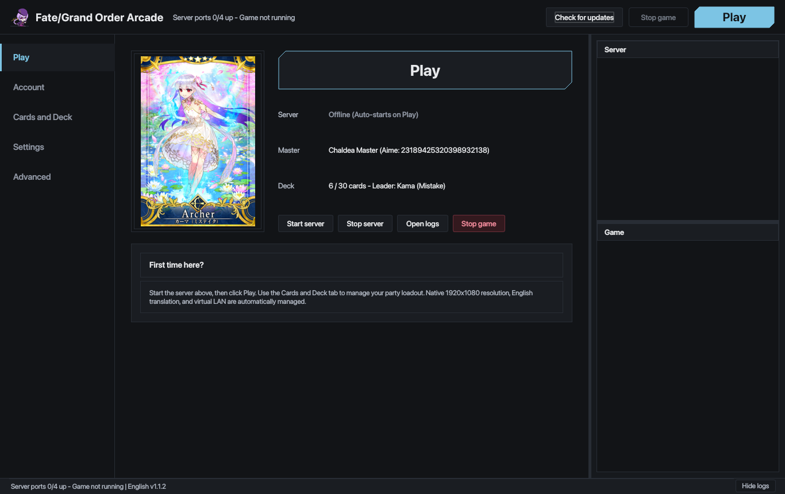
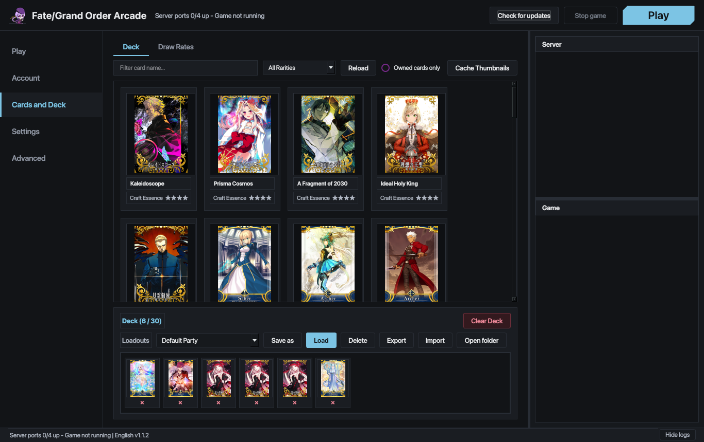
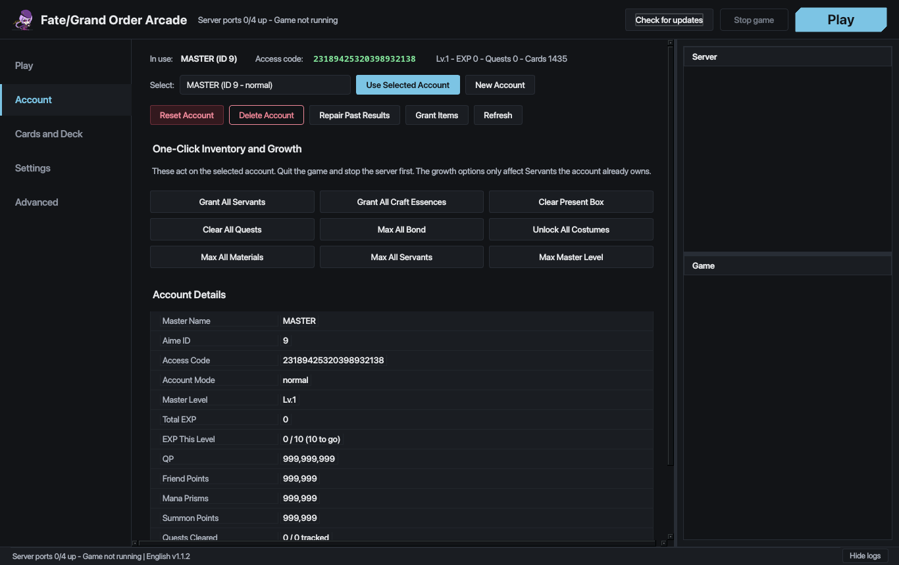
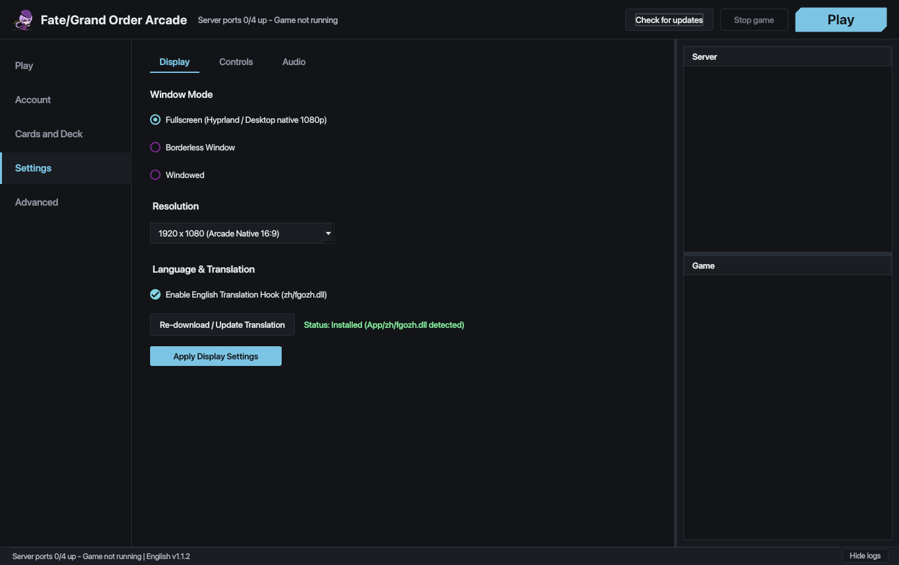

# Fate/Grand Order Arcade - Linux Launcher Overlay

[](https://www.python.org/)
[](https://www.riverbankcomputing.com/software/pyqt/)
[](https://kernel.org/)
[](packaging/arch/PKGBUILD)
[](LICENSE)

A high-performance, native Linux launcher and runtime orchestration overlay for **Fate/Grand Order Arcade**. Engineered as a **straight-up 1:1 Linux port of Scooby's launcher UI design** ([githubuser420x/FGOAC-scooby](https://github.com/githubuser420x/FGOAC-scooby)) rebuilt natively in Python and PyQt6 to attach directly onto **Cloud23333's FGO Arcade rip**, providing a seamless native desktop arcade experience without Windows or virtual machines.

---

## Highlights

- **1:1 Port of Scooby's Arcade Cabinet Aesthetic**: Direct recreation of Scooby's WPF launcher theme featuring 45-degree chamfered geometry, responsive cyan glows, and crisp typography.
- **Dedicated First-Run Setup Wizard**: 5-step arcade-themed setup dialog featuring live game root validation, ROM version badges (`11.00` vs `11.51`), card catalog detection, multi-part archive extraction with password handling, partition disk space checks, and background progress logging.
- **On-Demand Embedded Server Stack**: Auto-starts local MariaDB (port 3307) and Artemis server (ports 8777, 8443, 22345) when launching the game, and automatically shuts them down on exit—zero background overhead when not playing.
- **Universal Linux Game Launcher**: Auto-detects GPU configurations (NVIDIA `prime-run`, AMD/Intel `RADV`), manages Wayland / Hyprland tearing and fullscreen rules, injects translation hooks (`zh/fgozh.dll`), and synchronizes network routing.
- **Integrated Card & Deck Builder**: Visual card catalog with 30-card team loadout presets, servant asset resolution, and JSON serialization.

---

## Interface Showcase

| Arcade Play Dashboard | Card Catalog & Responsive Deck Shelf |
|:---:|:---:|
|  |  |
| **Account Management & Growth Tools** | **Settings & Keybindings** |
|  |  |

---

## Cloud23333 Game Rip & Update Guide

The game files are sourced from **Cloud23333's FGO Arcade package**. When obtaining game files from the shared repository, follow these guidelines:

### What to Download:
1. **Base Game V1.00**:
   - `FGOA V1.00 Base Game` split RAR archives (`.part1.rar` through `.part5.rar`).
2. **Cumulative Update V1.10**:
   - `FGO-1.10.bin` (or `FGO-1.10-patch.zip` / update archive).
   > [!IMPORTANT]
   > **Update V1.10 is cumulative** and upgrades the game from ROM 11.00 to 11.51 with all servant balance adjustments and content up to the final arcade release. **You do NOT need V1.01 or V1.02.**
3. **Daily Settlement & Summon Hotfix**:
   - `FGO-1.10-daily-settlement-hotfix-20261005.zip` (contains `repair_battle_summon.py`).
   - Resolves login settlement crashes and battle summon reward loops.

### Archive Password:
All Cloud23333 encrypted archives use the password:
```text
bilibili Cloud23333
```
*(The setup wizard automatically uses this password when extracting archives).*

---

## Prerequisites

Ensure the following packages are installed on your Linux distribution:

### Arch Linux / Manjaro
```bash
sudo pacman -S python python-pyqt6 python-yaml wine mariadb iproute2 7zip
```

### Ubuntu / Debian
```bash
sudo apt install python3 python3-pyqt6 python3-yaml wine mariadb-server iproute2 p7zip-full
```

### Fedora
```bash
sudo dnf install python3 python3-pyqt6 python3-pyyaml wine mariadb-server iproute p7zip
```

---

## Installation & Quickstart

### Method 1: Standalone Desktop App (Recommended)

Install the launcher into your user environment as a native desktop application with menu shortcuts:

1. Clone or download this repository:
   ```bash
   git clone https://github.com/Min34r/fgo-ac-loonix.git
   cd fgo-ac-loonix
   ```

2. Run the standalone installer:
   ```bash
   ./install.sh
   ```
   This installs the launcher into `~/.local/share/fgoa-launcher/`, creates the `fgo-launcher` command in `~/.local/bin/`, installs high-resolution desktop icons, and registers an application menu entry (`Fate/Grand Order Arcade`).

3. Launch the application:
   ```bash
   fgo-launcher
   ```
   *(Or open "Fate/Grand Order Arcade" from your system application menu).*

4. **Arcade Setup Wizard**:
   On first launch, if the game is not yet configured, the launcher presents a dedicated 5-step Arcade Setup Wizard:
   - **Option A: Select Extracted Game Folder**:
     - Browse to an existing Cloud23333 folder containing `App/ago.exe`.
     - Live validation confirms the game root, detects the ROM version (`11.00` vs `11.51`), and reports available servant cards.
     - Automatically applies Linux compatibility patches and launches the game dashboard.
   - **Option B: Extract Game Rip Archive(s)**:
     - Select downloaded `.rar`, `.zip`, or `.7z` archives.
     - Automatically resolves multi-part archives (`.part1.rar` to `.part5.rar`).
     - Checks target partition free disk space (~26 GB recommended).
     - Extracts archives with the Cloud23333 password, unpacks cumulative update `FGO-1.10.bin`, removes obsolete 11.00 files, applies `repair_battle_summon.py`, and runs binary patches with live streaming logs.

---

### Method 2: Attach Directly to an Existing FGOA Directory

If you prefer to attach the launcher directly to an existing game folder without installing to `~/.local/share`:

```bash
./install.sh /path/to/FGOA
```
*(Add `--desktop` if you would like an application menu shortcut created).*

---

### Method 3: Arch Linux Native Package (`PKGBUILD`)

Build and install a system package:
```bash
cd packaging/arch
makepkg -si
```
Installs system-wide to `/opt/fgoa-launcher/` with binary `/usr/bin/fgo-launcher`.

---

## Arcade Loopback Network (192.168.100.1)

Fate/Grand Order Arcade expects the local cabinet server at `192.168.100.1`. When playing locally, the launcher will automatically attempt to bind this alias on-demand, or you can bind it manually:

```bash
sudo ip addr add 192.168.100.1/24 dev lo
```

---

## Controllers & Input Mapping

FGO Arcade supports keyboard, PlayStation DualSense, Xbox controllers, and arcade fight sticks.
See the comprehensive [**Controller Configuration Guide**](docs/CONTROLLERS.md) for button mappings, touch screen simulation, and Steam Input setup.

---

## Verification & Testing

### Headless Verification Test
To verify the launcher, Qt stack, and configuration headlessly without spawning a window:
```bash
fgo-launcher --headless-test
```
*(Or `./FGO_Launcher.sh --headless-test` from the repository root).*

---

## Repository Structure

```
fgoa-launcher/
├── FGO_Launcher.sh              # Root launcher entrypoint
├── install.sh                   # Automated overlay installer & standalone desktop setup
├── requirements.txt             # Python dependencies
├── LICENSE                      # MIT License & attribution notice
├── README.md                    # Project documentation
├── docs/
│   └── CONTROLLERS.md           # Gamepad, arcade stick & touch mapping guide
├── packaging/
│   └── arch/
│       ├── PKGBUILD             # Arch Linux package build script
│       ├── .SRCINFO             # Arch Linux source info metadata
│       ├── fgo-arcade-launcher.desktop # Desktop application menu entry
│       └── fgo-arcade-launcher.install # Post-install pacman hook script
├── assets/
│   └── screenshots/             # Interface showcase images
├── deck-loadouts/               # Starter 30-card team loadout presets
│   ├── Default Party.json
│   └── Mash Kyrielight Starter.json
├── scripts/
│   ├── patch_game_binaries.py   # Hex-level Wine & OpenGL compatibility hotpatcher
│   ├── launch_linux.sh          # Universal GPU-detecting game runner
│   ├── setup_prefix.sh          # Automated Wine prefix & font installer
│   ├── install_translation.sh   # CLI English translation downloader & installer
│   ├── patch_server_artemis.sh  # Artemis Python 3.12+ & Linux compatibility patcher
│   ├── start_server_native.sh   # Native MariaDB + Artemis server starter
│   ├── stop_server_native.sh    # Native server stack stopper
│   └── mariadb_native.cnf.template # Dynamic MariaDB configuration template
└── launcher/
    ├── fgo_launcher.py          # Application entrypoint & setup wizard hook
    ├── assets/
    │   ├── platform.png         # High-resolution 256x256 application icon
    │   └── platform.ico         # Legacy application icon
    ├── core/
    │   ├── config.py            # Centralized dynamic path resolver & game root locator
    │   ├── translation_installer.py # In-app translation downloader & extractor
    │   ├── card_catalog.py      # Card bitmap scanner and deck serializer
    │   ├── game_process.py      # Non-blocking QProcess runner
    │   ├── network_sync.py      # Virtual LAN / loopback synchronization
    │   └── server_manager.py    # Socket monitor and service manager
    └── ui/
        ├── chamfer.py           # 45° chamfered buttons & container widgets
        ├── theme.py             # Palette, OpaqueComboBox, and global QSS styles
        ├── setup_wizard.py      # 5-step arcade setup dialog with live validation & logs
        ├── main_window.py       # Main window, navigation, and log drawer
        ├── play_view.py         # Play dashboard & leader card portrait
        ├── account_view.py      # Profile metrics & 1-click inventory tools
        ├── cards_view.py        # Card catalog, pagination & responsive deck shelf
        ├── settings_view.py     # Display, keybindings, and audio settings
        └── advanced_view.py     # Network sync, 8-point diagnostics, and About
```

---

## Credits & Attributions

We gratefully acknowledge the creators and contributors whose work makes running Fate/Grand Order Arcade on Linux possible:

- **UI Design (1:1 Port)**: **[Scooby](https://github.com/githubuser420x/FGOAC-scooby)**  
  This launcher's interface is a faithful, straight-up 1:1 Linux port of Scooby's original Windows WPF launcher design, replicating the authentic arcade cabinet aesthetic, 45-degree chamfered buttons, color scheme, navigation layout, and deck builder for the Linux desktop.

- **Platform & Server Rip**: **Cloud23333**  
  Special credit and appreciation to Cloud23333 for the Fate/Grand Order Arcade package, Artemis server integration, database administration tools, and platform backend.

- **Game Intellectual Property**:  
  *Fate/Grand Order Arcade* is developed by **Sega Corporation** and **Type-Moon** / **Lasengle**. This repository contains only open-source launcher and orchestration code and distributes no proprietary game binaries or assets.

---

## License

This project is released under the [MIT License](LICENSE).
See [LICENSE](LICENSE) for full details and acknowledgments.
